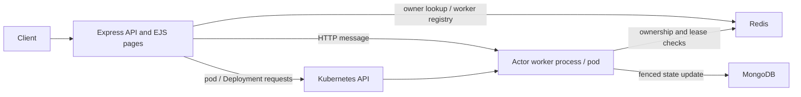

# ActorLab

ActorLab is an educational virtual-actor runtime demonstrating how stable actor
identities and durable state can be hosted by a changeable pool of Node.js
workers. Express provides both a JSON API and a server-rendered EJS console.
MongoDB stores actor state and message/event records; Redis coordinates worker
heartbeats, actor ownership, and a leased singleton. Kubernetes manifests run
the API, workers, MongoDB, and Redis and allow the API to inspect pods and
request worker Deployment scaling.

This repository is a runnable demonstration, not a production-ready actor
platform. See [Limitations and future scope](docs/LIMITATIONS_AND_FUTURE_SCOPE.md)
before using it outside a trusted development environment.

## What problem does it address?

In a process-local implementation, an actor's identity, state, and execution
are tied to one process. That makes worker replacement, restart, and scaling
harder to demonstrate. ActorLab keeps actor IDs independent of worker IDs,
persists actor state in MongoDB, and keeps placement and coordination data in
Redis. The runtime can route an operation to a worker and move eligible actors
between live workers without changing their IDs.

## Features

- Three built-in actor types: `CounterActor`, `BankAccountActor`, and
  `GlobalSchedulerActor`.
- MongoDB-backed actor state, durable sequenced messages, migration records, and optimistic version checks.
- Per-actor sequential request queues within each worker process, backed by a
  Redis execution lease for cross-Pod serialization.
- Redis worker heartbeats and actor-to-worker ownership records.
- Direct HTTP message dispatch from the API to the selected worker, with worker polling to recover pending MongoDB messages.
- Best-effort duplicate suppression using caller-supplied message IDs and
  bounded processed-message history; this is not exactly-once delivery.
- A Redis-locked automatic actor-count rebalancer that runs on worker changes
  and every 10 seconds once two live workers are available.
- A Redis TTL lease and fencing generation for the built-in scheduler actor.
- Kubernetes pod discovery, pod-log retrieval, and HPA-backed worker autoscaling.
- EJS pages for actors, workers, rebalancing, singleton status, and cluster
  status.

See the [project overview](docs/PROJECT_OVERVIEW.md) and
[architecture report](docs/SYSTEM_ARCHITECTURE.md) for the actual component
flows and limitations.

## Technology stack

| Technology                   | Purpose in this repository                                                     |
| ---------------------------- | ------------------------------------------------------------------------------ |
| Node.js (ES modules)         | API server and independent worker processes                                    |
| Express                      | JSON endpoints, internal coordinator endpoints, form routes, and static assets |
| EJS                          | Server-rendered application pages                                              |
| MongoDB / Mongoose           | Durable actor records, message-result records, and expiring runtime events     |
| Redis                        | Worker hash, actor ownership hash, singleton lease and generation              |
| Kubernetes JavaScript client | Pod/Deployment inspection, pod logs, and worker scaling                        |
| Docker / Docker Compose      | Container image and local multi-container development setup                    |
| Kubernetes                   | Runs and restarts the sample API, worker, MongoDB, and Redis Deployments       |
| Prettier                     | Source formatting through `npm run format`                                     |

## Architecture at a glance

The API accepts client messages, reads the actor record, validates or resolves
the current owner using Redis and the worker registry, then makes a bounded
HTTP request to that worker. The worker serializes requests for the same actor
in its local mailbox queue, validates the Redis ownership generation, applies
the operation, and conditionally persists the new MongoDB state/version before
returning a result. Kubernetes hosts the processes and provides pod lifecycle
management; Redis and MongoDB remain application-level coordination and state
services.



The diagrams and detailed explanations are in
[docs/diagrams/](docs/diagrams/) and [System architecture](docs/SYSTEM_ARCHITECTURE.md).

## Project structure

```text
.
├── docs/                 Technical guides, report support, and Mermaid diagrams
├── k8s/                  Namespace, app, database, cache, and RBAC manifests
├── public/               Browser JavaScript and CSS
├── scripts/              EJS-aware formatting helper
├── src/
│   ├── config/           MongoDB, Redis, and Kubernetes clients
│   ├── middleware/       Express async/error handling
│   ├── models/           Mongoose Actor, Message, and RuntimeEvent schemas
│   ├── routes/           JSON API, internal API, and page routes
│   ├── runtime/          Worker process and per-actor request queue
│   ├── services/         Actor coordination and Kubernetes operations
│   └── views/            EJS application pages
├── .env.example
├── docker-compose.yml
└── Dockerfile
```

## Requirements

- Node.js 22 (the Dockerfile uses `node:22-alpine`) and npm are recommended.
- MongoDB and Redis for actor operations. Docker Compose can start local
  instances.
- Docker for the Compose/image workflows.
- For Kubernetes workflows: `kubectl` and a reachable cluster; Minikube is one
  local option.

## Local setup

From the repository root, in PowerShell:

```powershell
npm install
Copy-Item .env.example .env
docker compose up -d mongodb redis
npm start
```

In a second terminal, start a worker:

```powershell
npm run worker
```

Open <http://localhost:3000>. The API and worker both need reachable MongoDB
and Redis URLs. For additional local workers, use a unique worker ID and port
per terminal, and make sure the advertised worker host is reachable from the
API:

```powershell
$env:WORKER_ID = "worker-local-2"
$env:WORKER_PORT = "3102"
npm run worker
```

For automatic Node restart during API development, run `npm run dev` instead of
`npm start`. The available commands are listed in
[Configuration](docs/CONFIGURATION.md).

To seed 200 idle `CounterActor` records (`actor-3` through `actor-202`) into
MongoDB, start MongoDB and run:

```powershell
npm run seed
```

The seed command leaves existing records with those IDs unchanged, so it can be
run again safely.

For the repeatable presentation dataset, use:

```powershell
npm run demo:seed
```

This resets demo actors, messages, migrations, and runtime events, then creates
counter, bank-account, and singleton actors. The Actors page also provides a
visible reset control; type `RESET DEMO` to confirm it. Worker registrations
are preserved so the live demo can be reset without restarting workers. See
[the presentation guide](docs/PRESENTATION_GUIDE.md) for the complete
demonstration script.

## Docker Compose

The Compose file starts MongoDB, Redis, one API container, and one worker
container:

```powershell
docker compose up --build
```

The API is exposed on port 3000. MongoDB and Redis are bound to localhost ports
27017 and 6379 for local Node processes; containers use the service names
`mongodb` and `redis` instead. MongoDB and Redis data use named volumes.
Compose's example MongoDB and Redis services are unauthenticated and are for
local development only. Stop the services with `Ctrl+C`; `docker compose down`
keeps named volumes. Removing volumes is destructive to local data and is not
required for normal shutdown.

## Kubernetes / Minikube

The manifests use the `actorlab` namespace and the local image name
`actorlab:latest`. With Minikube:

```powershell
minikube start
docker build -t actorlab:latest .
minikube image load actorlab:latest
kubectl apply -f k8s/
kubectl -n actorlab get deployments,pods,services
kubectl -n actorlab port-forward service/actorlab-api 3000:3000
```

Then open <http://localhost:3000>. The sample includes a single API replica,
a worker HPA with a two-pod minimum and ten-pod maximum, single-replica
MongoDB and Redis Deployments, and an API NodePort Service. The HPA scales from
average CPU (60%) and memory (70%) utilization; the Cluster page shows its
live replica range and targets. The API's service account can inspect worker
pods/logs and the HPA, plus list nodes through a cluster-scoped read-only binding.

The sample connection Secret contains unauthenticated in-cluster URLs, not
credentials. Configure authentication, persistence, network policy, and a
cluster-appropriate image/secret workflow before production use. See
[Kubernetes integration](docs/KUBERNETES_INTEGRATION.md) and the
[deployment guide](docs/DEPLOYMENT_GUIDE.md).

## Pages

| Page                        | Purpose                                                                  |
| --------------------------- | ------------------------------------------------------------------------ |
| `/`                         | Runtime metrics, actor placement, service indicators, events             |
| `/project`                  | In-app architecture walkthrough                                          |
| `/actors` and `/actors/:id` | Create actors, inspect state, submit operations, change displayed status |
| `/workers`                  | Redis worker registry, actor assignments, and discovered worker pods     |
| `/rebalancing`              | Live automatic balancing, worker distribution, and migration history     |
| `/singletons`               | Built-in scheduler actor and Redis lease status/events                   |
| `/cluster`                  | Kubernetes status, pod details/logs, and HPA autoscaling state           |
| `/guide`                    | Demonstration checklist and exact triggers for heartbeat, idling, balancing, and scaling |

## API and internal endpoints

The public JSON API is mounted at `/api`; the worker-to-coordinator endpoints
are mounted at `/internal`. The complete endpoint list, request/response
examples, and errors are in the [API reference](docs/API_REFERENCE.md).
Internal endpoints are not authenticated and should not be exposed to
untrusted networks.

## Formatting and checks

Format supported project files (including EJS templates):

```powershell
npm run format
```

There is no automated test script or checked-in test suite in `package.json`.
Manual verification scenarios and their expected results are documented in
[Testing and validation](docs/TESTING_AND_VALIDATION.md).

## Screenshots

No screenshots are included in this repository. Add genuine screenshots of
your running local or Kubernetes deployment here if desired; do not treat
illustrative diagrams as application screenshots.

## Limitations and future work

The sample still has no authentication or TLS, uses single-replica MongoDB and Redis, and provides no cross-database transaction. Redis execution leases and MongoDB fencing reduce stale writes but are not production-grade distributed guarantees. Resource metrics fall back to actor counts when Metrics Server is unavailable. Run `npm run test:integration` with `ACTORLAB_API_URL` set to exercise the verified actor flows. See
[Limitations and future scope](docs/LIMITATIONS_AND_FUTURE_SCOPE.md) for a
fuller list and possible next steps.

## Documentation map

- [Project overview](docs/PROJECT_OVERVIEW.md)
- [Problem statement and objectives](docs/PROBLEM_STATEMENT.md),
  [scope](docs/OBJECTIVES_AND_SCOPE.md)
- [System architecture](docs/SYSTEM_ARCHITECTURE.md),
  [architecture decisions](docs/ARCHITECTURE_DECISIONS.md), and
  [component design](docs/COMPONENT_DESIGN.md)
- [Actor model](docs/ACTOR_MODEL.md), [lifecycle](docs/ACTOR_LIFECYCLE.md),
  [message processing](docs/MESSAGE_PROCESSING.md), and
  [state management](docs/STATE_MANAGEMENT.md)
- [Worker management](docs/WORKER_MANAGEMENT.md),
  [rebalancing](docs/DYNAMIC_REBALANCING.md), and
  [singleton actors](docs/SINGLETON_ACTORS.md)
- [Kubernetes integration](docs/KUBERNETES_INTEGRATION.md),
  [database design](docs/DATABASE_DESIGN.md), and
  [API reference](docs/API_REFERENCE.md)
- [Deployment](docs/DEPLOYMENT_GUIDE.md), [configuration](docs/CONFIGURATION.md),
  [security considerations](docs/SECURITY_CONSIDERATIONS.md),
  [testing](docs/TESTING_AND_VALIDATION.md), and
  [troubleshooting](docs/TROUBLESHOOTING.md)
- [Runtime requirement assessment](docs/REQUIREMENT_ASSESSMENT.md)
- [College project report guide](docs/PROJECT_REPORT_GUIDE.md)
