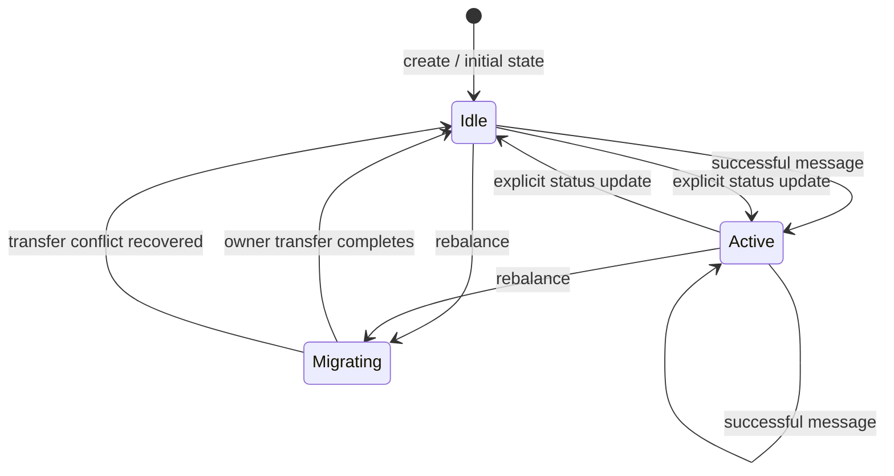
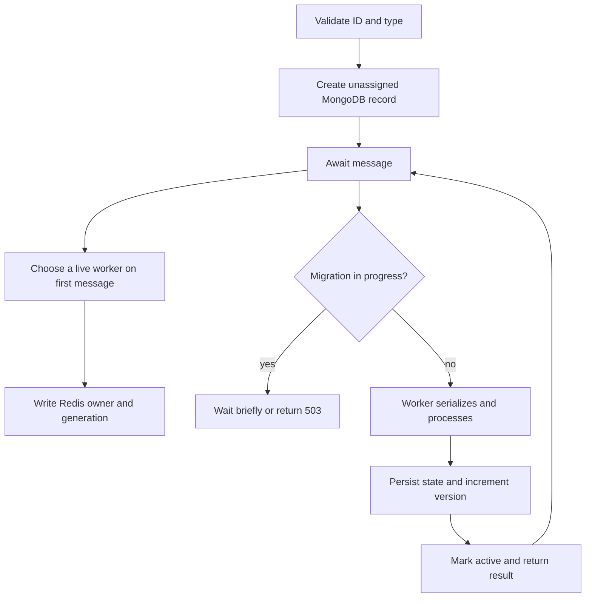

# Actor lifecycle

## Lifecycle stages

1. **Create:** API validates the actor ID/type and creates a durable MongoDB
   record with no owner. The first message assigns it to a live worker.
2. **Uninitialized record:** new actors have `status: uninitialized` and no
   owner. The dashboard shows `UNASSIGNED` until first use.
3. **Activation and execution:** API durably queues the message and resolves a
   live worker and generation. The worker loads MongoDB state into a per-process
   actor instance, obtains an actor-scoped Redis execution lease, processes the
   next actor sequence, persists state, and acknowledges the message.
4. **Idle deactivation:** a configurable timeout (60 seconds by default)
   deactivates cached instances under the same execution lease. State is written
   before the instance is removed; later messages reload and reactivate it.
5. **Migration:** eligible actors enter `migrating`; the source rejects new
   work and drains its execution lease. Redis ownership is compare-and-set to a
   higher generation before MongoDB records the destination.
6. **Recovery:** workers scan durable pending messages and load assigned actor
   state after restart. Periodic rebalancing repairs interrupted migrations and
   dead-owner assignments.

See [actor_lifecycle.mmd](diagrams/actor_lifecycle.mmd). The displayed
`active`/`idle` status should not be confused with a runtime-managed
passivation/activation protocol: execution is document-per-message, and
`migrating` is the only status that causes the routing path to wait/reject.

## Failure and recovery boundaries

After a worker has committed an actor update to MongoDB, another worker can
reload the persisted state. The API does not automatically retry every
unreachable worker request or preserve it in a queue. When it resolves ownership
again, it can choose a live worker and increment the assignment generation.
Rebalancing can also move assignments after stale worker registrations are
pruned.

## Diagram

Related: [Message processing](MESSAGE_PROCESSING.md),
[state management](STATE_MANAGEMENT.md), and
[rebalancing](DYNAMIC_REBALANCING.md).
