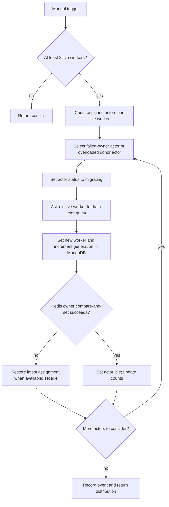

# Dynamic actor rebalancing

## What the implementation does

Rebalancing runs periodically in the API process (30 seconds by default) and
can also be manually triggered (`POST /api/rebalance` or the Rebalancing page).
A Redis coordinator lock prevents overlapping runs. It requires at least two workers considered live by the
Redis heartbeat registry. It loads assigned actors except
`GlobalSchedulerActor`, counts actors assigned to currently live workers, and
moves actors when the most-loaded and least-loaded worker counts differ by
more than one. Actors assigned to workers no longer live are prioritized and
may be moved even without that count difference.

This is actor-count balancing, not measured CPU/memory/latency balancing. The
periodic pass detects registry changes indirectly; it does not watch Pod events.

## Transfer steps

For each selected actor:

1. Read the current Redis ownership assignment (or fall back to the actor's
   MongoDB generation).
2. Mark the MongoDB actor document `migrating`.
3. If the old worker is live, POST its drain endpoint and wait for its current
   in-process queue tail. The transfer continues if the HTTP request fails.
4. Set the target worker and incremented generation in MongoDB.
5. Compare-and-set the Redis owner hash against the assignment previously
   observed.
6. On Redis failure, mark the actor idle and throw. On CAS conflict, restore
   the latest Redis assignment into MongoDB when present, mark idle, and
   continue. On success, mark idle and update distribution counts.
7. Record a summary runtime event and return moved count and distribution.

The target worker does not preload the actor. On its next operation it reads
the durable MongoDB state.

## Example

With four eligible actors and two live workers, a distribution of A=3, B=1 has
a difference of two. A successful move can produce A=2, B=2. This is an
illustrative arithmetic example, not a measured result. If the difference is
one or zero, the rebalancer stops moving actors.

## Diagram

Standalone diagram: [actor_rebalancing.mmd](diagrams/actor_rebalancing.mmd).

## Boundaries and caveats

- The drain endpoint waits for the current local queue tail; it is not a
  distributed barrier. Requests already routed to an old worker can race with
  the migration.
- Redis ownership transfer is compare-and-set, but MongoDB assignment is
  written before Redis CAS. Failure recovery attempts to reconcile the actor
  document to the latest Redis owner.
- The routine uses sequential awaits, so moving many actors is not parallel.
- There is no rollback transaction spanning actor status, MongoDB, worker
  queue, and Redis.
- It excludes the singleton actor and does not proactively rebalance new
  actors if worker availability changes.

Related: [Message processing](MESSAGE_PROCESSING.md),
[Worker management](WORKER_MANAGEMENT.md).
