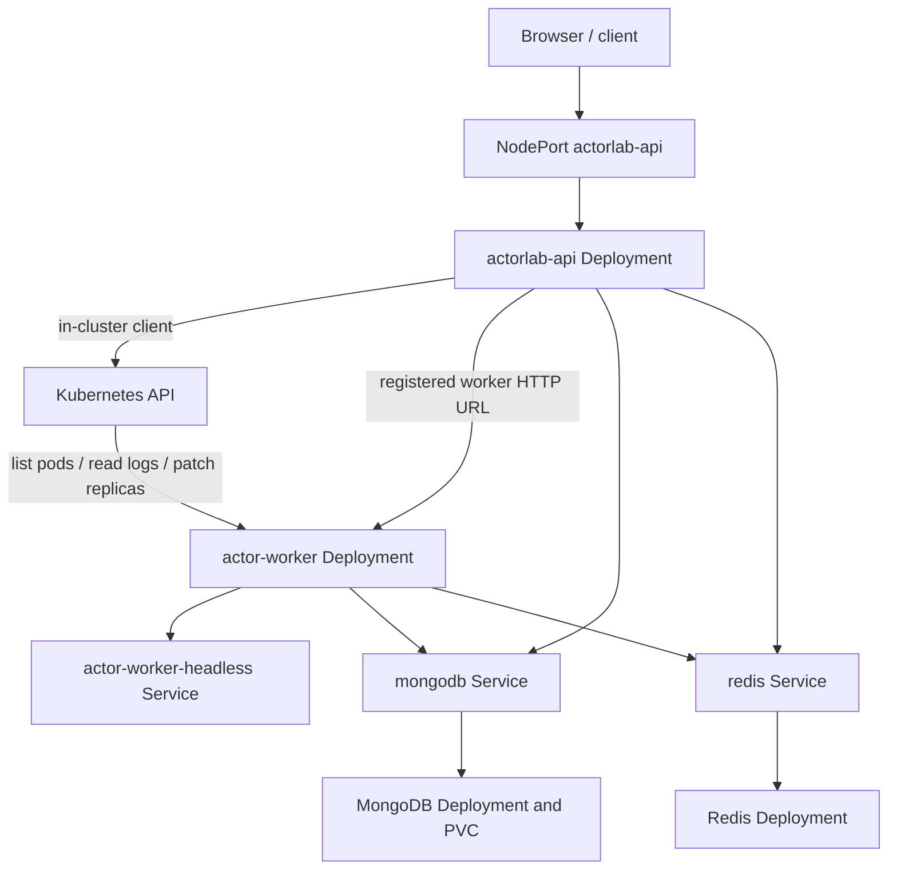

# Kubernetes integration

## Client behavior

The API creates `CoreV1Api`, `AppsV1Api`, and `AutoscalingV2Api` clients with
`@kubernetes/client-node`. It first attempts in-cluster configuration and falls
back to the default local kubeconfig. Runtime operations are scoped by
`K8S_NAMESPACE` (default `actorlab`) and `WORKER_DEPLOYMENT` (default
`actor-worker`).

The service lists pods selected by `app=actor-worker`, reads the worker
Deployment's spec, reads up to 100 lines of pod logs, and patches the worker
Deployment replica count. The JSON API and page validate requested replicas in
the range 0–50. Kubernetes request timeout defaults to 3000 ms. If no client is
configured or the query fails, the UI/API reports local/unavailable status.
The status helper retains the Deployment spec and status, and lists actual
nodes and Pod readiness conditions. CPU and memory metrics are not queried.

## Resources in this repository

| File                        | Kubernetes resources                                                         | Purpose                                                             |
| --------------------------- | ---------------------------------------------------------------------------- | ------------------------------------------------------------------- |
| `00-namespace.yaml`         | Namespace `actorlab`                                                         | Isolates sample objects                                             |
| `01-configmap.yaml`         | ConfigMap `actorlab-config`                                                  | Non-secret ports, runtime mode, heartbeat/timeout and cluster names |
| `02-secrets.example.yaml`   | Secret `actorlab-connections`                                                | Example MongoDB/Redis URLs; sample has no credentials               |
| `03-mongodb.yaml`           | PVC `mongodb-data`, Deployment and Service `mongodb`                         | One MongoDB pod with a 5Gi PVC                                      |
| `04-redis.yaml`             | Deployment and Service `redis`                                               | One Redis pod using append-only persistence argument, no PVC        |
| `05-rbac.yaml`              | ServiceAccount, Role, RoleBinding `actorlab-api`                             | Permits pod get/list, pod log get, and get/patch on `actor-worker`  |
| `06-api.yaml`               | Deployment `actorlab-api`, NodePort Service `actorlab-api` (node port 30080) | Runs API with the restricted service account                        |
| `07-workers.yaml`           | Deployment `actor-worker`, headless Service `actor-worker-headless`          | Starts two worker replicas and provides per-pod DNS                 |
| `08-worker-autoscaler.yaml` | HPA `actor-worker-autoscaler`                                                | Automatically keeps 2–10 workers based on CPU and memory demand     |

## Worker discovery and communication

The API does not send actor messages through the Kubernetes API. Workers
register their HTTP URL in Redis and the API sends direct HTTP requests to that
URL. The worker Deployment supplies pod name, namespace, and pod IP through the downward
API. Pod name is the worker identity. If no explicit `WORKER_ADVERTISE_HOST` or `POD_IP` is set, the worker
builds the name
`<POD_NAME>.actor-worker-headless.actorlab.svc.cluster.local`.
This DNS fallback embeds the `actorlab` namespace and assumes the sample
headless Service name. Keep the namespace and service name aligned if adapting
the manifests.

Kubernetes handles pod scheduling, container restarts, readiness probes,
Services, and the requested Deployment replica count. ActorLab handles worker
registry heartbeats, actor ownership, message routing, state persistence,
singleton lease, and its automatic rebalancing operation.

## Scaling and failure

The HPA automatically maintains 2–10 `actor-worker` pods at 60% average CPU
or 70% average memory utilization. New worker containers register and heartbeat
after startup. ActorLab automatically rebalances actor ownership after joins,
drains, and on a 10-second coordinator interval, but only after two workers
are live. The sample uses readiness/liveness probes, resource requests, a
termination grace period, and an autoscaler; it does not include NetworkPolicy,
TLS, or database authentication.

See [deployment guide](DEPLOYMENT_GUIDE.md) and
[deployment_architecture.mmd](diagrams/deployment_architecture.mmd).
