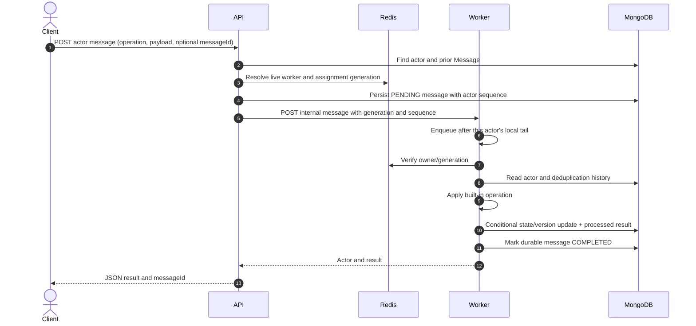

# Message processing

## Request contract

The public endpoint is `POST /api/actors/:id/messages`. Its JSON body requires
a string `operation` of at most 80 characters. `payload`, when present, must be
a non-array object. `messageId` is optional and, when supplied, must be a
string no longer than 120 characters. The API generates a UUID if omitted.

Supported operations and payloads are actor-type specific; see
[Actor model](ACTOR_MODEL.md) and the [API reference](API_REFERENCE.md).

## Pipeline

1. The API validates the request and reads the MongoDB actor record.
2. It allocates a per-actor sequence under a Redis enqueue lock and persists a
   `PENDING` MongoDB message before dispatch. Existing IDs reuse the stored row.
3. `ensureActorOwner` resolves a live worker, current Redis assignment, and
   generation. A singleton actor also requires an active lease.
4. The API sends an HTTP POST to the selected worker with the durable message
   ID, sequence, and ownership generation. A dispatch failure leaves the row
   pending for worker recovery or a caller retry.
5. The worker serializes work by actor ID within its process, then obtains a
   Redis `SET NX PX` execution lease so a second Pod cannot process that actor
   concurrently while the lease is valid.
6. The worker checks Redis ownership/generation, checks the message log and
   recent processed-message cache, checks MongoDB assignment, and (for the
   scheduler) validates the singleton lease generation.
7. Built-in actor logic computes the next state/result from the activated
   in-memory actor instance.
8. MongoDB conditionally updates actor state/version and processed-message
   history, then marks the durable message `COMPLETED`. A failed operation is
   recorded as `FAILED`; stale `PROCESSING` rows return to `PENDING` after the
   processing lease expires.

## Sequence diagram

The standalone diagram is [message_flow.mmd](diagrams/message_flow.mmd).

## Ordering, retries, and guarantees

- **Ordering:** messages have a sequence allocated under a distributed enqueue
  lock. Workers refuse to process a sequence while an earlier message is pending.
  The execution lease serializes the actor across Pods.
- **Retry:** an unreachable worker returns `503`, while the durable message stays
  pending. Assigned workers poll pending messages and callers may retry with the
  same `messageId`.
- **Deduplication:** completed message IDs are unique in MongoDB, and actor
  documents retain the last 256 processed results as a recovery aid. Duplicate
  retries return the prior result when the durable message is completed.
- **Commit order:** actor state and processed ID are saved before the durable
  message is acknowledged. A crash between those writes is repaired from the
  actor processed-ID history. The writes are not a MongoDB transaction.
- **Guarantee:** do not call this exactly-once. It is synchronous,
  best-effort duplicate suppression with a durable state update and bounded
  deduplication history.

The Redis execution lease is renewed during long processing and before state
persistence verifies the lock token. MongoDB version and ownership conditions
remain the final stale-write guards; Redis and MongoDB do not share a transaction.

## Failures

Invalid operation/payload and actor-specific rule failures return `400`; an
insufficient balance returns `409`. Stale owner/version conflicts return
`409`. An unknown actor returns `404`. No worker, unreachable worker, or
prolonged migration returns `503`; coordinator/worker request timeouts can
also surface as an error. The common API error middleware returns
`{ "error": "..." }`.

Related: [State management](STATE_MANAGEMENT.md),
[Worker management](WORKER_MANAGEMENT.md), and
[Limitations](LIMITATIONS_AND_FUTURE_SCOPE.md).
