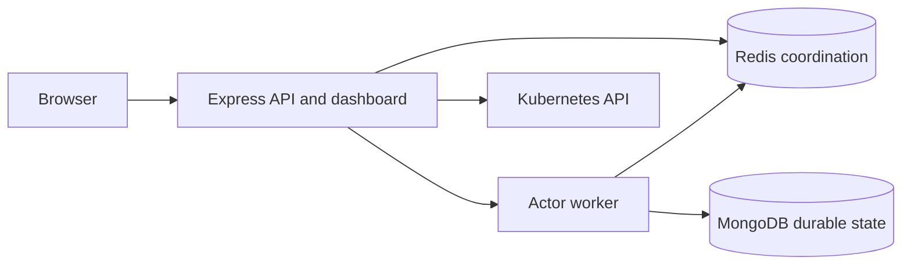

# ActorLab presentation guide

## Project topic

**ActorLab: Durable virtual actors with distributed worker coordination and
dynamic rebalancing.**

ActorLab demonstrates how a logical actor can keep a stable identity and
durable state while different worker processes execute its messages.

## One real-world analogy: food delivery

Use an online food-delivery platform as the single story for the presentation:

- `order-pizza-1001` is one customer's order. Its actor state records the
  order events even if a worker pod changes.
- `restaurant-wallet-7` is the restaurant's wallet. Deposits and withdrawals
  are processed sequentially so the balance cannot be corrupted by concurrent
  requests.
- `GlobalSchedulerActor` is the platform scheduler. Redis allows only one
  worker to hold its lease at a time, preventing duplicate scheduling.
- Worker pods are the delivery operations team. Kubernetes can add, remove,
  restart, and inspect them while actor identities remain stable.

Say this during the demo: **"The actor is the order or wallet; the worker is
only the employee currently handling it."**

## Problem statement

In a process-local application, an actor's identity and state are tied to one
server. A restart, failure, or scale-out can lose state or route messages to
the wrong process. ActorLab separates actor identity from worker processes and
coordinates ownership across workers.

## Objectives

- Keep actor state durable across worker restarts.
- Process messages sequentially for each actor.
- Coordinate worker heartbeats and actor ownership.
- Move actors between workers without changing their IDs.
- Demonstrate exclusive singleton ownership with a Redis lease.
- Expose the behavior through an inspectable web dashboard.

## Architecture



- **Express API:** accepts messages, resolves owners, and serves the console.
- **Workers:** serialize operations per actor and persist results.
- **MongoDB:** stores actors, state, messages, versions, and migrations.
- **Redis:** stores heartbeats, ownership generations, and singleton leases.
- **Kubernetes:** can scale and inspect worker pods.

## Technologies

Node.js, Express, EJS, MongoDB, Mongoose, Redis, Docker Compose, Kubernetes,
and the Kubernetes JavaScript client.

## Repeatable demo setup

From the project root:

```powershell
Copy-Item .env.example .env
npm install
docker compose up -d mongodb redis
npm run demo:seed
npm start
```

In a second terminal:

```powershell
npm run worker
```

Open <http://localhost:3000>. The Actors page also has a visible reset control.
Type `RESET DEMO`, then run `npm run demo:seed` again whenever a clean
presentation dataset is needed.

## Kubernetes presentation setup

Use this path when the Cluster page must show real pods and Deployment data.
Docker Desktop must be running, and `minikube` and `kubectl` must be available
in the same PowerShell window:

```powershell
minikube start --driver=docker
docker build -t actorlab:latest .
minikube image load actorlab:latest
kubectl apply -f k8s/
kubectl -n actorlab rollout status deployment/mongodb --timeout=180s
kubectl -n actorlab rollout status deployment/redis --timeout=180s
kubectl -n actorlab rollout status deployment/actorlab-api --timeout=180s
kubectl -n actorlab rollout status deployment/actor-worker --timeout=180s
kubectl -n actorlab port-forward service/actorlab-api 3000:3000
```

Keep the port-forward terminal open and use <http://localhost:3000>. Before
starting the presentation, verify:

```powershell
kubectl -n actorlab get deployments,pods,services
```

Every application pod should be `Running` and ready. The Cluster page should
show `CONNECTED`, two ready worker pods, and one `minikube` node.

## Complete live demo script

Before presenting, open **Demo guide** in the application. It shows the live
configured timings and separates worker heartbeat, actor idling, application
rebalancing, and Kubernetes HPA scaling. Mark the actors you need to keep
visible with **Keep warm for demo** on the actor details page. This is useful
because a worker heartbeat proves a worker is alive; it does not keep an idle
actor instance active.

The following is the recommended 8-10 minute presentation sequence.

1. **Introduce the problem (30 seconds).** Explain that a normal
   process-local order object disappears or becomes unsafe when a server
   restarts or scales. ActorLab keeps the order identity and state separate
   from the worker process.
2. **Show the architecture (45 seconds).** On **How it works**, point out the
   Express API, Redis coordination, MongoDB durable state, worker pods, and
   Kubernetes API.
3. **Show infrastructure (45 seconds).** Open **Cluster status** and explain
   `CONNECTED`, the two ready worker pods, the node, and the scale control.
4. **Create an order actor (90 seconds).** Open **Actors**, create
   `order-pizza-1001` as `CounterActor`, activate it, and send increments of
   3 and 2. Explain that each message is queued for the same actor and show
   state `{ "count": 5 }`, version `2`, the assigned worker pod, and message
   history.
5. **Show a wallet actor (90 seconds).** Create
   `restaurant-wallet-7` as `BankAccountActor`, activate it, deposit `100`,
   then withdraw `20`. Show durable balance `80` and explain that the wallet
   is independent from the order actor and may be owned by another pod.
6. **Show worker distribution (45 seconds).** Open **Workers** and point out
   worker heartbeats, pod readiness, actor ownership, and the two actors being
   distributed across the two pods.
7. **Show coordination and rebalancing (60 seconds).** Open **Rebalancing**
   and use **Run rebalance now**. If distribution is already even, the expected
   result is `moved 0 actor(s)`; explain that this is a successful no-op. If
   actors are uneven, the page records a migration and the actor's durable
   state remains unchanged.
8. **Show singleton safety (45 seconds).** Open **Singletons** and show the
   active `GlobalSchedulerActor` lease, owner, expiry, and fencing generation.
   Explain that only one worker schedules platform-wide jobs.
9. **Show scaling (60 seconds).** On **Cluster status**, use **Request scale** to change replicas to
   `3`, apply, wait for the third pod to become ready, then return to `2`.
   Explain that Kubernetes changes worker capacity while actor IDs and MongoDB
   state remain stable.
10. **Close with persistence (30 seconds).** Deactivate and reactivate the
   order actor, then show that its count and message history remain. Finish
   with the limitations below.

For a clean local demonstration instead of Kubernetes, start the API and
workers as separate Node processes:

   ```powershell
   npm start
   ```

   In three additional terminals use worker IDs and ports `3101`, `3102`, and
   `3103`. This demonstrates the runtime without Kubernetes, but the Cluster
   page correctly reports local mode.

## Exact evidence to point out

| Screen | Evidence | Meaning |
|---|---|---|
| Dashboard | health, workers, singleton | runtime is operating |
| Actors | state, version, owner, messages | durable actor execution |
| Workers | heartbeats and pod readiness | worker liveness |
| Rebalancing | distribution and events | coordinated placement |
| Singletons | lease and fencing generation | exclusive ownership |
| Cluster | pods, node, replicas, logs | Kubernetes integration |

If a page is empty, do not invent data. Explain whether it means no messages,
no migrations were needed, or Kubernetes is unavailable.

## Expected results

- Actor state survives deactivation and reactivation.
- Each actor has one current owner at a time.
- Messages for one actor are sequenced and recorded.
- Duplicate message IDs do not apply the operation twice.
- Rebalancing changes placement, not actor identity or durable state.
- Only one worker holds the singleton lease at a time.

## Reset before repeating the presentation

For local mode, use the Actors page and type `RESET DEMO`, then run:

```powershell
npm run demo:seed
```

For Kubernetes mode, the same browser reset clears the application data inside
the cluster. Create the two food-delivery actors again through the Actors page.
Do not delete the namespace just to reset the story; that removes the
infrastructure evidence needed for the Cluster page.

## Limitations

This is an educational prototype, not a production cluster manager. The local
demo uses one MongoDB and one Redis instance. Resource-aware balancing depends
on Kubernetes metrics, and some crash, failover, and interrupted-migration
paths remain only partially tested. See
[REQUIREMENT_ASSESSMENT.md](./REQUIREMENT_ASSESSMENT.md) for the verified
coverage and remaining gaps.
