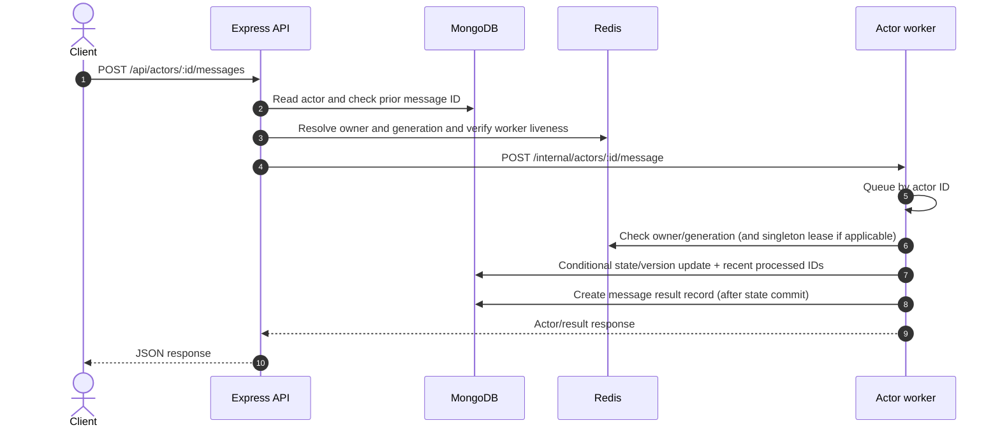
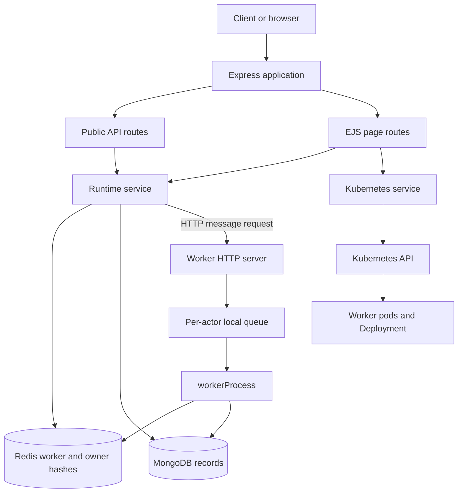

# System architecture

## 1. High-level architecture

ActorLab is a Node.js application split into an HTTP coordinator/API and
independently running worker HTTP servers. Both are started from
`src/server.js`; `--worker` selects worker mode. The API also serves EJS pages.
MongoDB stores actor records, message-result records, and runtime events.
Redis stores worker registrations, actor ownership assignments, and singleton
lease metadata. The Kubernetes client is used by the API to inspect pods/logs
and patch the worker Deployment; it is not the actor message transport.

The deployment and request path are shown in
[system_architecture.mmd](diagrams/system_architecture.mmd) and
[component_interaction.mmd](diagrams/component_interaction.mmd).

## 2. Component architecture

| Component                                             | Actual responsibility                                                                                                                                           |
| ----------------------------------------------------- | --------------------------------------------------------------------------------------------------------------------------------------------------------------- |
| Express API (`src/app.js`, `src/routes/api.js`)       | Parses JSON/forms, serves public JSON routes, invokes runtime services, and reports errors.                                                                     |
| EJS page routes (`src/routes/pages.js`, `src/views/`) | Reads database/Redis/Kubernetes data and renders the console pages.                                                                                             |
| Actor runtime service (`src/services/runtime.js`)     | Creates actors, resolves owner, routes messages, processes actor behavior in a worker, updates state, records events, rebalances, and manages singleton leases. |
| Actor registry                                        | MongoDB is the durable actor catalog; Redis `actorlab:owners` is the current owner/generation map.                                                              |
| Message router                                        | `sendMessage` in the API process resolves the owner, then uses HTTP to call that worker's `/internal/actors/:id/message`.                                       |
| Actor execution                                       | `workerProcess` validates Redis and MongoDB ownership/version, applies one of three built-in behaviors, and persists the resulting state.                       |
| Worker manager/registry                               | Workers self-register and heartbeat via `/internal`; Redis hash `actorlab:workers` tracks their advertised URLs and heartbeat details.                          |
| Worker process                                        | A worker runs an Express server, local per-actor promise queues, health/drain endpoints, registration, heartbeat, and lease renewal.                            |
| MongoDB                                               | Stores actor documents, message result records, and expiring runtime events.                                                                                    |
| Redis                                                 | Stores worker and owner hashes; singleton lease string, status hash, and generation counter. MongoDB is the durable mailbox; Redis Streams are not used.        |
| Kubernetes client                                     | Uses in-cluster config or local kubeconfig to list worker pods, read logs, and patch the named worker Deployment.                                               |
| Kubernetes                                            | Schedules/restarts containers and applies replica counts; it does not implement actor routing or move actor state.                                              |
| EJS dashboard                                         | Server renders actor/runtime/cluster observations; the pages use HTML form submissions for several actions.                                                     |

## 3. Communication and message path

The persisted actor state is reloaded for each worker operation. A worker does
not retain a continuously running JavaScript actor instance. Same-actor
serialization uses a local queue plus an actor-scoped Redis execution lease;
MongoDB version and ownership conditions reject stale writes. The lease is
time limited and the inbound queue is not durable.

### Component interaction

The standalone diagram is
[component_interaction.mmd](diagrams/component_interaction.mmd).

### Actor creation flow

1. The API validates the ID and one of three supported types.
2. MongoDB creates an `uninitialized` actor with initial state, generation 0, and
   no owner.
3. The first message is persisted with a per-actor sequence and assigned to a
   live worker. The worker activates the actor from MongoDB state on demand.
4. The Redis owner hash stores the live worker and monotonically increasing
   generation; MongoDB keeps the durable owner generation.
5. A runtime event is attempted. Actor creation does not require a worker.

### Dashboard data

The EJS routes query MongoDB, Redis-backed services, and (for cluster pages)
the Kubernetes API. The page request renders a snapshot; no web socket or live
push update is implemented. Refresh the page to observe later changes.

## 4. Infrastructure architecture

The same Docker image contains `src/` and `public/`. In local development,
`npm start` starts the API and `npm run worker` starts a worker. Docker Compose
starts one of each plus MongoDB and Redis. Kubernetes uses separate Deployments
for API and workers and separate single-replica Deployments for MongoDB and
Redis. The API Service is NodePort; the worker Service is headless for stable
pod DNS records.

The API patches the existing worker Deployment's `spec.replicas`; it does not
create Deployments or run an HPA. A new worker pod self-registers and starts
heartbeating. Scaling the Deployment alone does not rebalance actor ownership.
To redistribute actors, use the manual rebalancing endpoint/page.

MongoDB is used for actor state and history; Redis coordinates ownership and
liveness. Kubernetes pod readiness/restarts are separate from application
worker heartbeats. A pod can be running while the worker is not registered, or
registered while its advertised HTTP URL is unreachable.

See [deployment architecture](diagrams/deployment_architecture.mmd) and
[Kubernetes integration](KUBERNETES_INTEGRATION.md).

## 5. Design rationale and boundaries

- **Actor addressing:** clients use a stable actor ID rather than pinning a
  process address.
- **Independent workers:** workers can register and be added or removed without
  changing actor IDs.
- **MongoDB state:** current actor state remains after worker replacement.
- **Redis coordination:** heartbeats and ownership lookups are fast, shared
  coordination state; the Redis values themselves are not a durable queue.
- **Kubernetes:** container scheduling, health/restart policy, pod discovery,
  and replica count management are delegated to the cluster.
- **EJS:** the application includes an inspectable server-rendered operations
  console without a separate frontend build system.

These are implementation choices, not evidence that the services are
high-availability or production hardened. See
[Architecture decisions](ARCHITECTURE_DECISIONS.md) and
[Limitations](LIMITATIONS_AND_FUTURE_SCOPE.md).
